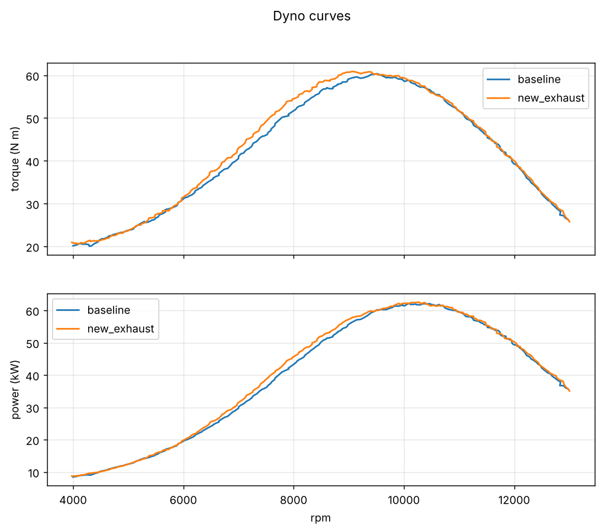
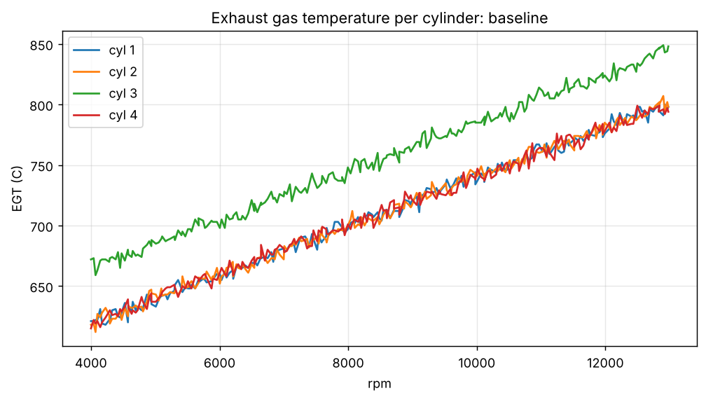

# dyno data analyzer

Command line analysis of engine dyno logs for a Formula SAE powertrain team: torque and power curves, peaks, per cylinder exhaust gas temperature (EGT) spread, and a binned comparison between two runs so a header or intake change can be judged by numbers instead of by eye.



```
$ dyno compare data/baseline.csv data/new_exhaust.csv
new_exhaust vs baseline
mean torque gain   +1.25%
peak power gain    +0.27 kW
best gain at       7550 rpm (+3.2 N m)
worst loss at      11650 rpm (-1.6 N m)

   rpm   d torque   d power
  4050      +0.6     +0.25
  4150      +0.3     +0.14
  ...
```

## Why

On PUCPR Racing I work on the powertrain, and most of what we decide comes from a dyno pull: did the new exhaust help, where, and did one cylinder get hotter. The data arrives as CSV from the dyno logger and the questions are always the same three, so I wrote a tool that answers them the same way every time.

## Install and test

```bash
git clone https://github.com/ZenNight/dyno-data-analyzer
cd dyno-data-analyzer
pip install -e ".[dev]"
pytest -q        # 10 tests
```

Dependencies: numpy and matplotlib. Python 3.10 or newer.

## Usage

```bash
dyno summary data/baseline.csv                      # peaks and EGT stats
dyno summary data/*.csv --json                      # machine readable
dyno compare data/baseline.csv data/new_exhaust.csv # candidate minus baseline, 100 rpm bins
dyno plot data/baseline.csv data/new_exhaust.csv --out out/curves.png
dyno egt data/baseline.csv --out out/egt.png        # one line per cylinder
```

### Input format

CSV with a header. Required: `time_s`, `rpm`, `torque_nm`. Optional: any number of `egt1_c`, `egt2_c`, ... columns, plus anything else (`lambda`, `map_kpa`), which is loaded into `run.extra`. Header matching is case insensitive. Power is always computed from torque and rpm, never read from the file, so two loggers with different power corrections still compare on the same basis.

### Sample data

`data/baseline.csv` and `data/new_exhaust.csv` are **synthetic**, generated by `data/make_synthetic.py`. They model a 600 cc four cylinder style curve with a mid range gain and a top end loss for the candidate, plus one deliberately hot cylinder in the baseline. They exist so the tool and the tests run anywhere. They are not measurements from the team's engine.

## What it computes

| command | output |
|---|---|
| `summary` | peak torque and rpm, peak power (kW and hp) and rpm, mean EGT per cylinder, max EGT spread across cylinders, which cylinder deviates most from the median |
| `compare` | torque and power deltas per rpm bin, mean torque gain in percent, peak power gain, rpm of the best gain and the worst loss |
| `plot` | torque and power curves for any number of runs on shared axes |
| `egt` | EGT per cylinder against rpm |



## Design decisions

**Compare on rpm bins, not on time.** Two pulls never sweep at the same rate, so sample 120 of one run is not sample 120 of the other. Averaging inside 100 rpm bins makes the subtraction meaningful, and bins with no samples stay NaN instead of being interpolated into fake data.

**Smooth before finding peaks.** Raw torque has sensor noise, and the argmax of noise is a random point. A 5 sample centered moving average with edge padding keeps the curve length and removes the jitter. The window is a flag, and `--smooth 1` disables it.

**Power is derived, always.** `P = T x omega`. One formula, one place (`Run.power_kw`), tested against the hand computation.

**EGT outlier via median deviation.** With four cylinders, the mean is pulled by the hot one; the median is not. The cylinder farthest from the median is flagged. It needs at least three cylinders to mean anything.

**No pandas.** The data is three to ten numeric columns. numpy plus the csv module keeps the install small and the code explicit.

## Tests

Ten tests: loading and validation (missing column, non increasing time), the power formula, moving average length and constant signal, rpm binning with an empty bin, peak positions on the sample data (power peaks after torque, as physics requires), the EGT outlier being cylinder 3 (because the generator made it 45 C hotter), the comparison finding a mid range gain and a top end loss, and the CLI producing JSON and PNG files.

One of those tests failed on the first run: the comparison did not find a top end loss because the synthetic candidate did not have one yet. The analysis was right about the data; the data did not match the story in this README. The generator was fixed, not the test.

## Known limitations

- No correction to standard atmosphere (SAE J1349 or DIN 70020). Runs on different days are not directly comparable without it. This is the next feature.
- `compare` assumes both runs are full throttle sweeps over overlapping rpm. Comparing a sweep against a steady state run will produce nonsense without a warning.
- EGT analysis is purely statistical. A hot cylinder can be a lean cylinder, a timing issue or a bad thermocouple; the tool points at it, it does not diagnose it.
- Peak values are taken from the smoothed curve, so they are slightly lower than the raw maximum. That is intended.

## Roadmap

- atmospheric correction factor from logged ambient pressure, temperature and humidity
- `--lambda` overlay on the EGT plot to separate lean cylinders from timing problems
- gear and wheel speed input so chassis dyno logs work too

## License

MIT
